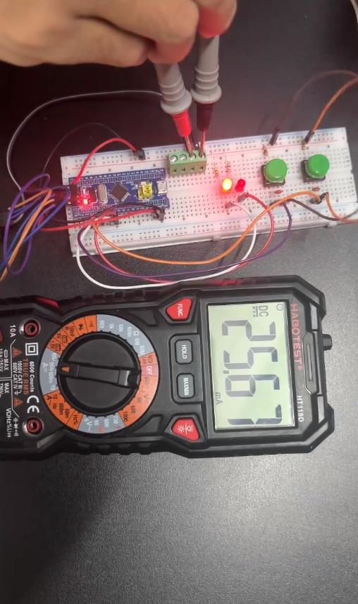
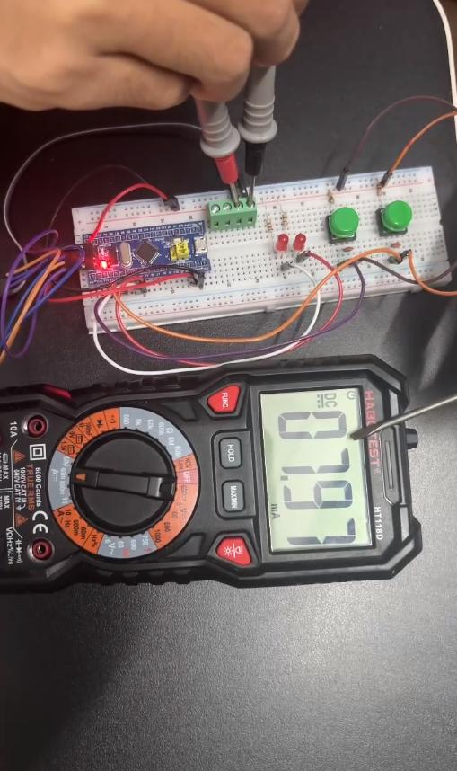
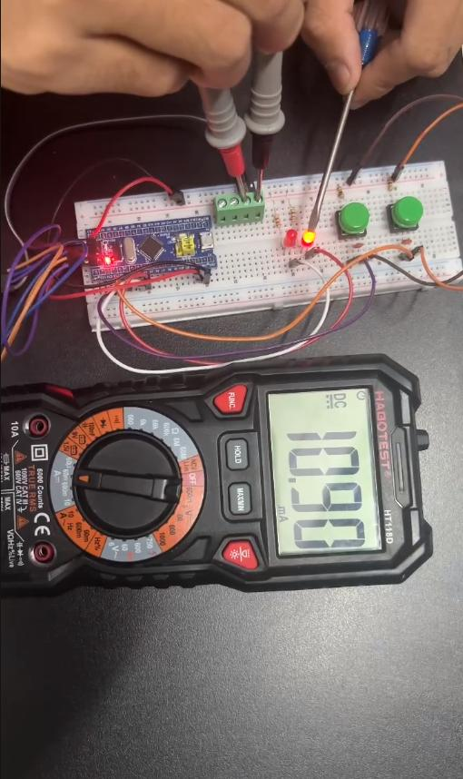
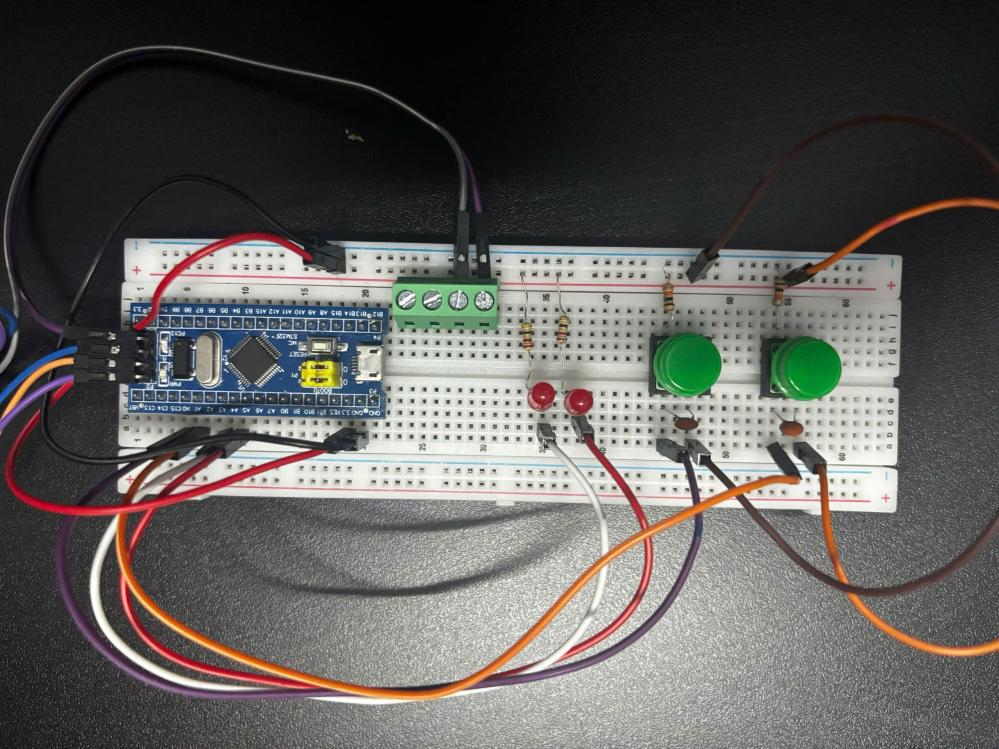
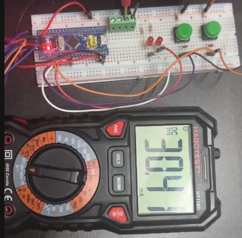
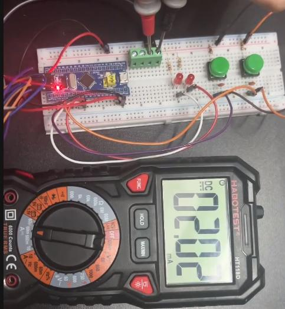
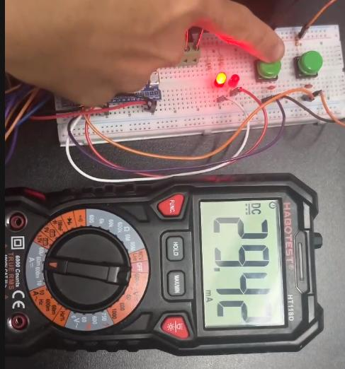
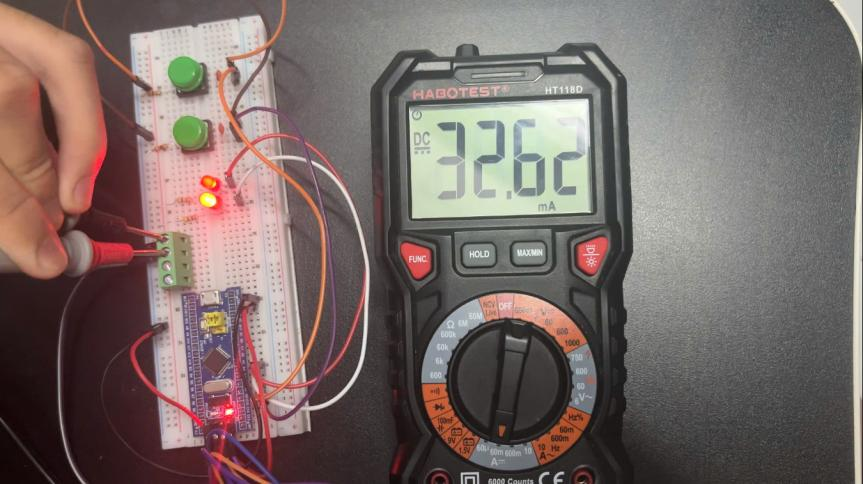
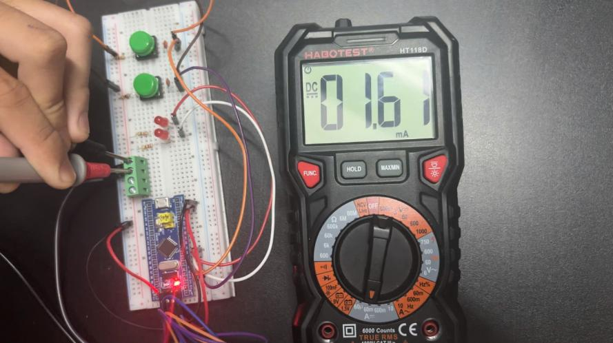
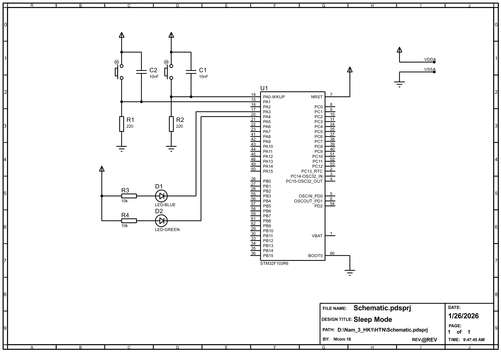

# STM32 Low Power — Sleep, Stop và Standby

Dự án nhóm môn Hệ thống nhúng, khảo sát ba chế độ tiết kiệm năng lượng trên bo mạch **STM32F103C8T6 Blue Pill**. Ba chương trình độc lập sử dụng nút nhấn để điều khiển vào/thoát chế độ công suất thấp, LED để quan sát hoạt động và đồng hồ đo dòng để ghi nhận kết quả thực tế. Dự án tập trung vào cơ chế đánh thức, khôi phục hoạt động và ảnh hưởng của trạng thái bo mạch đến dòng tiêu thụ.

## Công nghệ sử dụng

| Nhóm | Thành phần |
|---|---|
| Phần cứng | STM32F103C8T6, ST-LINK rời, breadboard, nút nhấn, LED và đồng hồ đo dòng |
| Firmware | C, STM32 HAL, CMSIS, GPIO, EXTI, SysTick, PWR; TIM1 trong Stop và Standby |
| Cấu hình | STM32CubeMX; các file `.ioc` khai báo STM32Cube FW_F1 V1.8.6 |
| Phát triển | Keil µVision/MDK-ARM; device pack Keil.STM32F1xx_DFP 2.4.1 |
| Sơ đồ | Proteus; schematic được cung cấp dưới dạng PDF |

### Cách hoạt động của ba chế độ

| Chế độ | Điều khiển | Xử lý trong firmware |
|---|---|---|
| Sleep | PA0 yêu cầu ngủ; lần nhấn PA0 tiếp theo đánh thức | Tạm dừng SysTick, vào Sleep bằng `WFI`; callback EXTI khôi phục SysTick khi thức dậy |
| Stop | PA0 yêu cầu vào Stop; PA1 đánh thức | Tạm dừng SysTick, vào Stop bằng `WFI` với bộ điều áp chính bật; sau PA1, cấu hình lại clock và khôi phục SysTick |
| Standby | PA1 yêu cầu vào Standby; PA0/WKUP đánh thức | Xóa cờ đánh thức, bật WKUP rồi vào Standby; sau đánh thức, chương trình khởi động lại |

Sleep dùng HSI/2 qua PLL ×16; Stop và Standby dùng HSE 8 MHz qua PLL ×8. Cả ba cấu hình hướng đến xung hệ thống 64 MHz. Mỗi chế độ có project riêng, không có menu chuyển đổi ba chế độ trong cùng một firmware.

## Vai trò và đóng góp cá nhân

Trong dự án nhóm, tôi trực tiếp:

- Cấu hình STM32CubeMX cho cả ba chế độ Sleep, Stop và Standby.
- Viết firmware điều khiển vào chế độ công suất thấp, đánh thức và quan sát trạng thái hoạt động.
- Chạy chương trình trên phần cứng thực tế, đo dòng tiêu thụ và ghi nhận kết quả của từng chế độ.

Các báo cáo và kết quả dưới đây thuộc phạm vi dự án nhóm.

## Kết quả thực nghiệm

Các ảnh được trích trực tiếp từ **Chương 4 — Kết quả thực nghiệm và phân tích** của từng báo cáo. Đây là dòng đo trên bo mạch và mạch thử nghiệm, có ảnh hưởng của LED nguồn, tải GPIO và linh kiện phụ trợ; không phải dòng tiêu thụ riêng của chip. Các phép đo có trạng thái tải và dòng Run khác nhau, nên không dùng bảng này để xếp hạng định lượng ba chế độ trong cùng một điều kiện chuẩn hóa.

| Thí nghiệm | Trạng thái | Dòng tiêu thụ |
|---|---|---:|
| Sleep | Run | ≈ 25,67 mA |
| Sleep | Sleep | ≈ 7,97 mA |
| Sleep | Sleep, có GPIO giữ mức HIGH | ≈ 10,90 mA |
| Stop | Trước khi vào Stop | 30,41 mA trên ảnh |
| Stop | Trong Stop | ≈ 2 mA; ảnh hiển thị 2,02 mA |
| Stop | Sau khi đánh thức | 29,42 mA trên ảnh |
| Standby | Run | ≈ 32,62 mA |
| Standby | Standby | ≈ 1,67 mA |

### Sleep

Dòng đo giảm từ khoảng 25,67 mA khi chạy xuống 7,97 mA khi Sleep. Trong phép thử Sleep có GPIO giữ mức HIGH, dòng đo khoảng 10,90 mA. Báo cáo phân tích ảnh hưởng của LED nguồn trên Blue Pill đến kết quả đo.

| Run | Sleep | Sleep với GPIO HIGH |
|---|---|---|
|  |  |  |
| Hình 9 | Hình 10 | Hình 11 |

Nguồn: [Báo cáo Sleep, mục 4.1–4.2](Sleep_mode/docs/sleep_mode_report.pdf#page=38), trang in 35–37, tương ứng trang PDF 38–40.

### Stop

Nút PA0 đưa hệ thống vào Stop; PA1 đánh thức để chương trình khôi phục clock và SysTick. Dòng trong Stop khoảng 2 mA. Các ảnh ghi nhận trạng thái trước khi ngủ, trong Stop và sau khi đánh thức.

Ảnh phần cứng — Hình 10

| Trước Stop | Trong Stop | Sau đánh thức |
|---|---|---|
|  |  |  |
| Hình 11 | Hình 12 | Hình 13 |

Nguồn ảnh: [Báo cáo Stop, mục 4.1–4.2](Stop_mode/docs/Stop_mode_report.pdf#page=29), trang in 26–28, tương ứng trang PDF 29–31.

### Standby

Nút PA1 đưa hệ thống vào Standby; PA0/WKUP đánh thức và chương trình khởi động lại. Dòng đo giảm từ khoảng 32,62 mA xuống 1,67 mA. Báo cáo nêu LED nguồn và các thành phần trên bo mạch là nguyên nhân khiến dòng thực tế cao hơn dòng riêng của vi điều khiển.

Ảnh phần cứng — Hình 13

| Run | Standby |
|---|---|
|  |  |
| Hình 14 | Hình 15 |

Nguồn: [Báo cáo Standby, mục 4.1–4.3](Standby_mode/docs/Standby_mode_report.pdf#page=30), trang in 27–28, tương ứng trang PDF 30–31.

## Tài liệu phần cứng

### Schematic tham khảo

Ảnh dưới đây được xuất từ một PDF schematic: [Sleep_Mode_Schematic.PDF](Sleep_mode/docs/Sleep_Mode_Schematic.PDF). Sơ đồ thể hiện kết nối hai nút nhấn và hai LED tới PA0, PA1, PA3, PA4.

**Khác biệt cần lưu ý:** ký hiệu U1 trong schematic là **STM32F103R6**, còn bo mạch và các project firmware sử dụng **STM32F103C8T6**. Dùng sơ đồ để tham khảo kết nối theo **tên GPIO**; không dùng số chân của ký hiệu R6 để đấu nối C8T6. Các giá trị linh kiện trong ảnh là giá trị của schematic, không phải bảng linh kiện đã xác minh cho mạch lắp thực tế.

### Bố trí GPIO trong các thí nghiệm

| GPIO | Sleep | Stop | Standby |
|---|---|---|---|
| PA0 | Nút vào/thoát Sleep, EXTI0 cạnh lên | Nút vào Stop, EXTI0 cạnh lên | Nút đánh thức WKUP |
| PA1 | Đầu vào điều khiển LED PA4 | Nút đánh thức, EXTI1 cạnh lên | Nút vào Standby, EXTI1 cạnh lên |
| PA3 | LED nhấp nháy trong vòng lặp chính | LED đảo trạng thái theo TIM1 | LED chạy vòng lặp chính |
| PA4 | LED phản ánh trạng thái PA1 | LED nhấp nháy trong vòng lặp chính | LED đảo trạng thái theo TIM1 |

## Hướng dẫn sử dụng

### Chuẩn bị

- Bo Blue Pill STM32F103C8T6, ST-LINK, mạch nút nhấn/LED và đồng hồ đo dòng như phần kết quả.
- Keil µVision/MDK-ARM với device pack **Keil.STM32F1xx_DFP 2.4.1** được khai báo trong project.
- Project Sleep chọn trình biên dịch Arm Compiler 5 (`uAC6=0`), không khai báo phiên bản cụ thể. Stop và Standby khai báo **Arm Compiler 6.24**. Kiểm tra trình biên dịch tương ứng trong cấu hình target trước khi build.
- STM32CubeMX nếu cần xem cấu hình `.ioc`; mã HAL và CMSIS đã có trong thư mục `Drivers/` của từng project.

### Mở, build và nạp firmware

1. Bắt đầu tại thư mục dự án đã tải về. Chọn **một** project trong bảng dưới và mở file `.uvprojx` bằng Keil µVision.
2. Kiểm tra target STM32F103C8, trình biên dịch và device pack. Có thể mở `.ioc` tương ứng để xem cấu hình; không cần sinh lại code chỉ để mở project có sẵn.
3. Đối chiếu cách đấu nút nhấn và LED theo tên GPIO. Với Standby, kiểm tra lại ánh xạ LED trước khi nạp: bản `main.c` hiện có gán PA4 cho `blink_led()` và PA3 cho callback TIM1, ngược với bố trí thí nghiệm trong bảng trên.
4. Kết nối ST-LINK qua SWD, kiểm tra cấu hình debugger/nạp Flash của target và chọn đúng thiết bị kết nối. Các file tùy chọn project có cấu hình ST-LINK.
5. Build target đã chọn, sau đó nạp firmware xuống bo mạch bằng chức năng Download của Keil. Mỗi lần chỉ nạp firmware của một chế độ.
6. Cho chương trình chạy và thao tác nút theo bảng hoạt động: PA0 vào/thoát Sleep; PA0 vào Stop và PA1 đánh thức; PA1 vào Standby và PA0 đánh thức.
7. Quan sát LED và ghi dòng ở trạng thái Run, trạng thái công suất thấp và sau đánh thức nếu cần. Ghi lại trạng thái LED, nguồn cấp và kết nối debugger để diễn giải phép đo theo đúng điều kiện thực tế.

| Chế độ | Project Keil | Cấu hình CubeMX | Mã chương trình |
|---|---|---|---|
| Sleep | [SLEEP_MODE.uvprojx](Sleep_mode/SLEEP_MODE/MDK-ARM/SLEEP_MODE.uvprojx) | [SLEEP_MODE.ioc](Sleep_mode/SLEEP_MODE/SLEEP_MODE.ioc) | [main.c](Sleep_mode/SLEEP_MODE/Core/Src/main.c) |
| Stop | [stopmode.uvprojx](Stop_mode/Stop_Mode/MDK-ARM/stopmode.uvprojx) | [stopmode.ioc](Stop_mode/Stop_Mode/stopmode.ioc) | [main.c](Stop_mode/Stop_Mode/Core/Src/main.c) |
| Standby | [stanby_mode.uvprojx](Standby_mode/Standby_Mode/MDK-ARM/stanby_mode.uvprojx) | [stanby_mode.ioc](Standby_mode/Standby_Mode/stanby_mode.ioc) | [main.c](Standby_mode/Standby_Mode/Core/Src/main.c) |

Hướng dẫn dựa trên mã nguồn và báo cáo dự án; các bước này không được thực thi trong quá trình biên soạn tài liệu.

## Báo cáo

- [Sleep Mode — báo cáo đầy đủ](Sleep_mode/docs/sleep_mode_report.pdf).
- [Stop Mode — báo cáo đầy đủ](Stop_mode/docs/Stop_mode_report.pdf).
- [Standby Mode — báo cáo đầy đủ](Standby_mode/docs/Standby_mode_report.pdf).

Các PDF gốc được giữ nguyên. Ảnh kết quả nằm trong `Images/results/`; ảnh schematic trích xuất nằm trong `Images/hardware/`.
